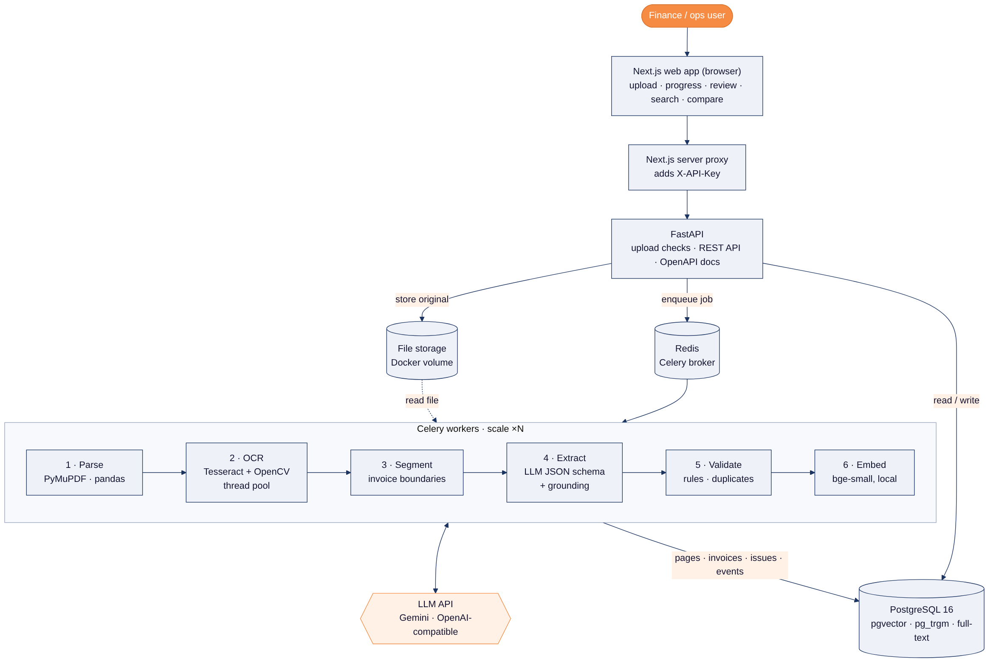
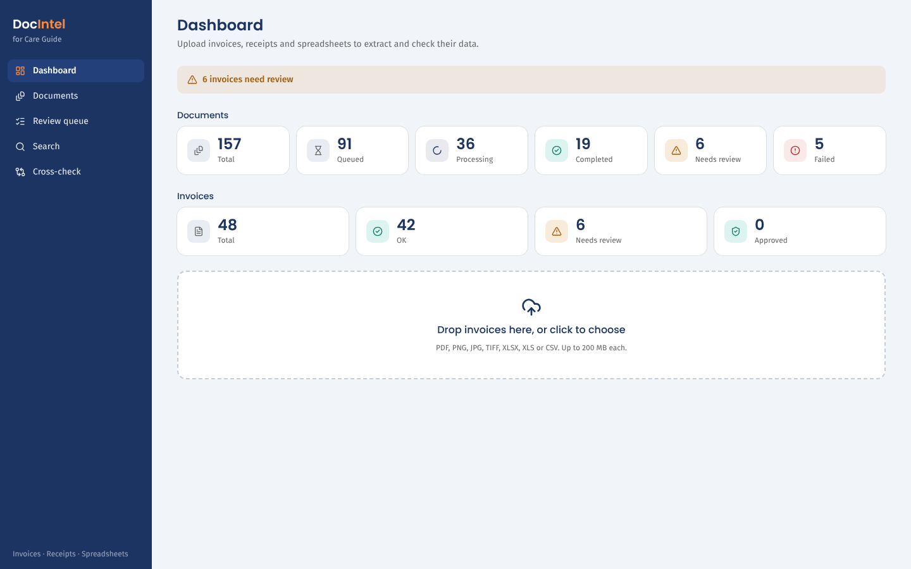
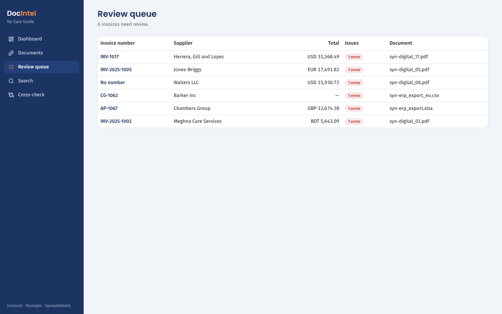
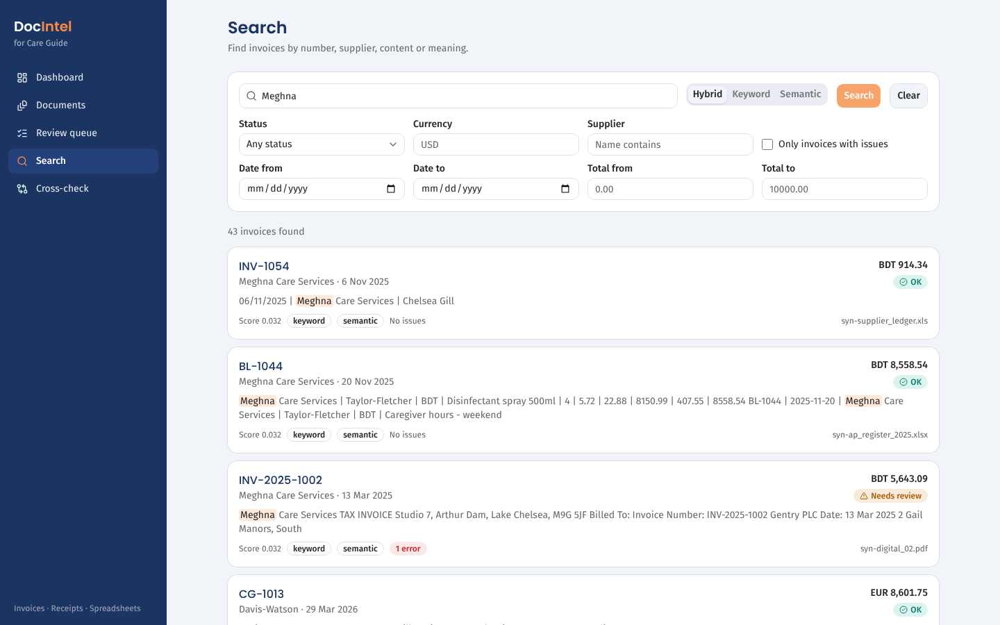
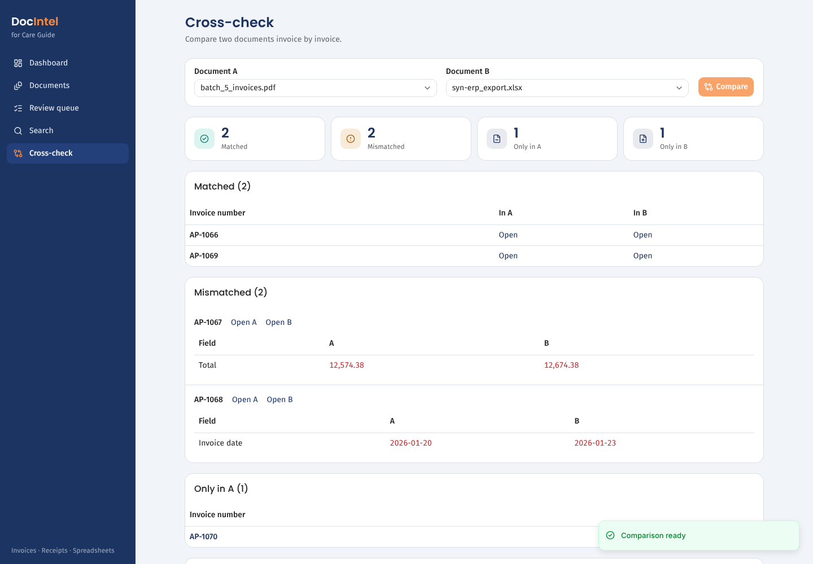

# DocIntel: AI Document Intelligence for invoices

Upload invoices, receipts, scans, photos and spreadsheets. DocIntel extracts structured invoice data with an LLM **without inventing values**, checks the arithmetic, finds duplicates, cross-verifies PDFs against other PDFs and Excel registers, routes anything doubtful to a human reviewer, and makes it all searchable by keyword and meaning.

Built for the Care Guide **Senior AI Engineer** assessment by Sartiz Alam Ayon.



## What it does

| | |
|---|---|
| **Formats** | PDF (digital, scanned, multi-page, many invoices per file, ~1000 pages), PNG, JPG, TIFF (multi-page), XLSX (multi-sheet), XLS, CSV |
| **Extraction** | invoice number, date, supplier, customer, subtotal, tax, total, currency, line items → JSON with per-field confidence |
| **No guessing** | missing → `null`. Every LLM value must be found in the source text (grounding), otherwise it is flagged for review |
| **Validation** | missing fields, invalid numbers/dates, qty × price = line, Σ lines = subtotal, subtotal + tax = total, duplicates |
| **Cross-verification** | PDF ↔ PDF and PDF ↔ Excel: matched, mismatched (field diffs), only-in-A, only-in-B |
| **Review** | page image beside editable fields, confidence chips, issue list, correction audit trail, approve |
| **Search** | filters + keyword (Postgres full-text and trigram) + semantic (local embeddings, pgvector) + hybrid |
| **Operations** | background jobs with live progress, retries, reprocess-failed, processing history per document |

## Quick start

Requirements: Docker Desktop (about 6 GB of images and volumes), and an LLM API key. The default is Google Gemini: get a free key at https://aistudio.google.com/apikey.

```bash
git clone https://github.com/sartizalamayon/careguide-docintel.git && cd careguide-docintel
cp .env.example .env          # set API_KEY (any long random string) and LLM_API_KEY
make up                       # or: docker compose up -d --build
```
- Web app: **http://localhost:3000**
- API docs (OpenAPI): **http://localhost:8000/docs** (send the header `X-API-Key: <API_KEY>`)
- Try it with the sample files in `datasets/eval/synthetic/`. For example, upload the whole `crosscheck/` folder, then open **Cross-check**.

Other commands: `make test`, `make lint`, `make logs`, `make data` (public labelled set), `make eval` (evaluation), `make help`.

Use another LLM by changing three env vars. For example, Groq: `LLM_BASE_URL=https://api.groq.com/openai/v1`, `LLM_MODEL=openai/gpt-oss-120b`.

## How it works

1. **Upload**: type allowlist, magic-byte check (a renamed file is caught), size limit, SHA-256. Bad files are rejected individually, with the reason.
2. **Parse** (background worker): PDF pages with a text layer are read directly. Scanned pages, photos and TIFFs go through Tesseract OCR with a *better-of-two* pass (plain vs deskew + adaptive threshold). Spreadsheets are parsed as tables with header detection and column-name mapping.
3. **Layout text**: words are placed by their x/y position, so side-by-side blocks and tables keep their structure for the LLM.
4. **Segment**: long PDFs are split into individual invoices using invoice-number and "Page 1 of N" cues.
5. **Extract**: one schema-constrained LLM call per invoice (temperature 0, cached, retried). Tabular spreadsheets need no LLM.
6. **Ground + validate**: values not found in the text are flagged. Arithmetic and duplicate rules run, and errors or low confidence send the invoice to the review queue.
7. **Index**: full-text vector + 384-d embedding (bge-small, runs locally) for hybrid search.

More: [Architecture and decisions](docs/ARCHITECTURE.md) · [Database schema](docs/schema.sql) · [Full specification](docs/SPEC.md) · [API reference](http://localhost:8000/docs)

## Screenshots

| Dashboard | Review queue |
|---|---|
|  |  |
| **Hybrid search** | **Cross-check of two documents** |
|  |  |

## Results

Measured end to end through the API on a **reduced 20-file subset** (12 valid documents with 35 invoices, plus 8 invalid files), using `gemini-2.5-flash-lite`. The full 160-file set could not be run because the available LLM key is on the free tier (20 requests per day). The subset checks the pipeline and failure handling, not accuracy on hard cases. Full report: [docs/EVALUATION.md](docs/EVALUATION.md).

| Metric | Value |
|---|---|
| Field accuracy (8 fields, micro-avg) | 100.0% (35 invoices) |
| Line-item F1 | 100.0% (118 of 118 items) |
| Hallucination rate (value where none exists) | 0.0% (1 null field in the subset) |
| Validation precision / recall | 100.0% / 100.0% (3 injected faults found) |
| Duplicate detection recall | not measured in the subset |
| Document success rate / failure rate | 100.0% / 0.0% (12 valid documents) |
| Corrupted files handled gracefully | 8 / 8 |
| Median processing time per document | 2.76 s (p95 4.50 s) |
| 1000-page PDF | not measured |

## Tests

`make test` runs the unit and integration tests (real Postgres + Redis, Celery eager mode, a fake LLM). They cover parsing for every format, OCR, segmentation, extraction and grounding, validation rules, API endpoints and failure scenarios. Latest run: [eval/results/test-report.txt](eval/results/test-report.txt).

## Project layout

```
backend/    FastAPI app, Celery worker, pipeline (pdf, ocr, spreadsheets, segment, extract, validate, search), tests
frontend/   Next.js 15 + shadcn/ui: dashboard/upload, documents, review, search, cross-check
datasets/   labelled evaluation data + tools that fetch/generate it
eval/       evaluation runner and committed results
docs/       architecture, schema, spec, plan, datasets, evaluation, AI disclosure
```

## Security notes

API-key auth (the key stays server-side behind the Next.js proxy), CORS allowlist, upload allowlist + magic bytes + size caps, decompression-bomb and sheet/page caps, server-generated storage paths, parameterised SQL, non-root containers, secrets only via env, and prompt-injection-resistant extraction (data-only prompt, strict JSON schema, grounding).

## Limitations

English documents only (Tesseract `eng`). Segmentation needs an invoice number or "Page x of y" on each invoice. No user accounts or roles (single API key). Files are stored on a local volume (S3 would be the production swap).

## AI-assisted development

AI tools were used for research, design, documentation and implementation. What was done by whom, and every runtime prompt, is listed in [docs/AI_DISCLOSURE.md](docs/AI_DISCLOSURE.md).

## Walkthrough video

TODO: link to the recorded walkthrough.
