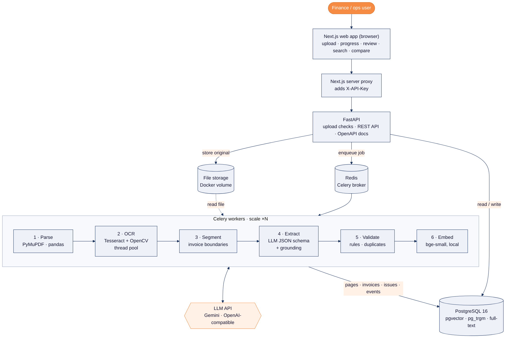
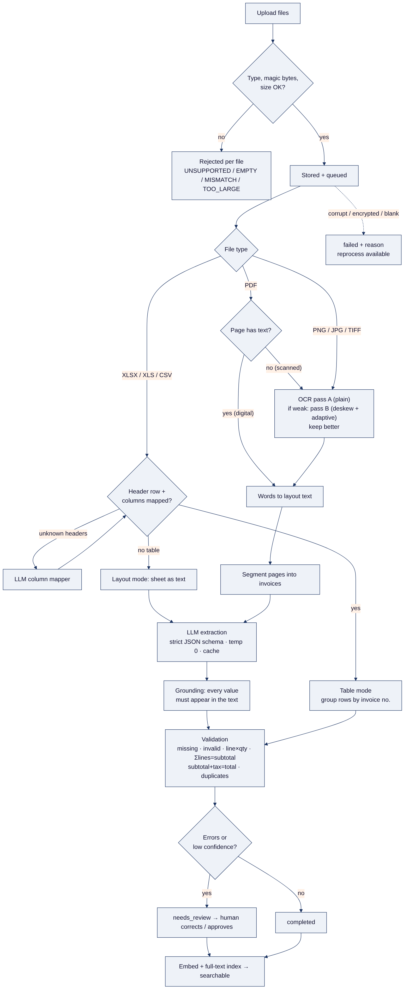
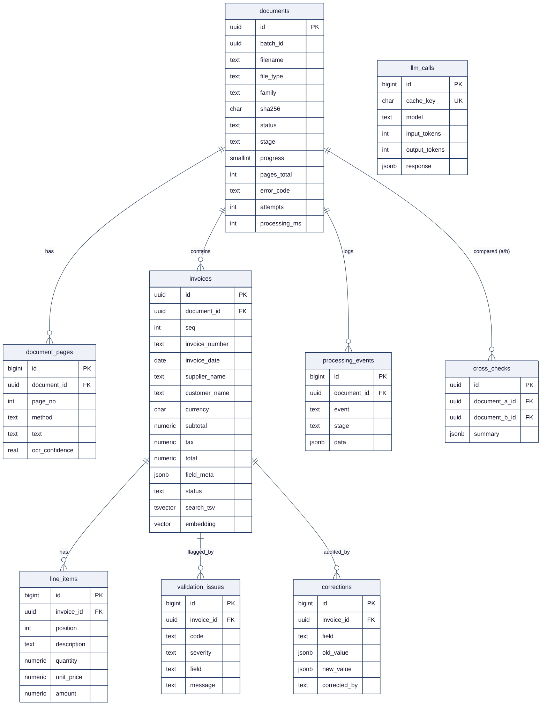

# Architecture

DocIntel turns invoice files (PDF, scans, photos, spreadsheets) into validated, searchable records. The design goal is **correct data or an explicit flag, never a confident guess**.

## Components

| Component | Tech | Responsibility |
|---|---|---|
| Web | Next.js 15, shadcn/ui, TanStack Query | Upload, progress, review and correction, search, cross-check. A server-side proxy keeps the API key off the browser |
| API | FastAPI | Validates uploads (type, magic bytes, size), stores files, enqueues jobs, and serves results, search, corrections and cross-checks |
| Queue | Redis + Celery | Durable background jobs with acks-late, retries with backoff, and time limits |
| Worker(s) | Celery, PyMuPDF, Tesseract, OpenCV, pandas | Parse → OCR → segment → LLM extract → ground → validate → embed. Scale horizontally with `--scale worker=N` |
| LLM | Gemini (OpenAI-compatible endpoint) | Schema-constrained JSON extraction. Swappable by env vars |
| Embeddings | fastembed bge-small (local ONNX) | 384-d vectors for semantic search. No external calls |
| Database | PostgreSQL 16 + pgvector + pg_trgm | Metadata, page text, invoices, issues, corrections, history, FTS and vector index |
| Storage | Docker volume | Original files at server-generated paths |

## Processing pipeline

1. **Upload (sync).** Extension allowlist, magic-byte check, size limit, streaming SHA-256. A bad file is rejected individually and the rest of the batch continues.
2. **Parse (worker).** Each PDF page is either *digital* (PyMuPDF words) or *scanned* (rendered at 300 dpi and OCR'd in a thread pool). Images and TIFF frames are OCR'd. Spreadsheets are read sheet by sheet with header detection and column mapping.
3. **Layout text.** Words are placed on a character grid by their x position, so two-column headers ("Seller / Client") and tables stay readable for the LLM. PDF and OCR text share the same renderer.
4. **Segment.** A 1000-page PDF usually holds many invoices. Pages are split into invoices with invoice-number and "Page 1 of N" cues (deterministic, no LLM cost).
5. **Extract.** One LLM call per invoice segment, run concurrently, with temperature 0, a strict JSON schema, retries and a response cache. Tabular spreadsheets skip the LLM entirely, because their cells are already structured.
6. **Ground.** Every extracted value must be found in the source text (fuzzy for names, format variants for numbers and dates). An unsupported value is kept for the reviewer but flagged `UNGROUNDED_VALUE`. Missing values stay `null`.
7. **Validate.** Missing fields, invalid numbers and dates, line × qty, Σ lines = subtotal, subtotal + tax = total, and duplicates. Any error sends the invoice to the review queue.
8. **Index.** Full-text vector (`tsvector`) + embedding (`vector(384)`) for hybrid search.

## Data model

The full DDL is in [`schema.sql`](schema.sql). Key points:
- A **document** (file) has many **pages** (text per page or sheet) and many **invoices**.
- An **invoice** keeps per-field `field_meta` (confidence, grounded, source = llm / table / manual), its **line items**, **validation issues** (recomputed on every change) and **corrections** (audit trail).
- **processing_events** is the append-only history of every stage, retry, failure, correction and approval.
- **cross_checks** stores PDF↔PDF and PDF↔spreadsheet comparison reports.
- **llm_calls** logs tokens and latency and doubles as a response cache, so reprocessing and re-evaluation cost nothing.

## Key design decisions

| Decision | Alternatives considered | Why this one |
|---|---|---|
| Python end to end (FastAPI + Celery) instead of NestJS + BullMQ | NestJS API + Python OCR microservice | OCR, pandas and the LLM SDKs are Python. One language means one deployable and less glue. Celery gives the same queue semantics as BullMQ |
| Postgres + pgvector instead of a separate vector DB | Qdrant, Pinecone, Mongo Atlas | One transactional store. Filters, FTS and vectors live in the same SQL query, so there is no sync problem at this scale (millions of rows fit) |
| Tesseract with best-of-two preprocessing | PaddleOCR, docTR, cloud OCR, vision LLM | CPU-only, ~0.8 s/page, no API cost or data egress. Measured: adaptive thresholding fixes phone photos (conf 24→84) but hurts some clean scans (93→47), so both passes run and the better one is kept |
| Text LLM over layout-preserving text | Send page images to a vision LLM | Cheaper and faster per page. Text is needed for search and grounding anyway, and grounding is only possible against text |
| Deterministic table parsing for spreadsheets | Always use the LLM | Cells are already structured. An LLM would only add cost and hallucination risk. The LLM is used only to map unknown headers or read "invoice-shaped" sheets |
| Grounding check + "null, never guess" prompt | Trust the LLM output | The brief requires that values are never invented. Grounding turns that into a measurable property (the hallucination rate in the evaluation) |
| Duplicates only within the same *family* (documents vs spreadsheets) | Global duplicate check | A spreadsheet register legitimately repeats the PDFs' invoices. That relationship is handled by cross-verification instead of false duplicate alarms |
| Local embeddings (bge-small) | Gemini embeddings API | Free, private and fast enough on CPU. No quota competition with extraction |
| OpenAI-compatible client | Provider SDKs | The provider is swapped by env vars (Gemini, Groq, OpenAI, Ollama), so there is no lock-in |

## Scalability and performance

- The API does no heavy work. It streams uploads to disk and enqueues.
- Throughput scales linearly with workers (`docker compose up --scale worker=4`). Inside a worker, OCR pages run in a thread pool (Tesseract releases the GIL) and LLM calls run concurrently per document.
- 1000-page PDFs are streamed page by page with bounded look-ahead, so memory stays flat. Progress is committed every 25 pages.
- The LLM response cache makes retries and reprocessing free. Rate limits are absorbed by exponential backoff, and jobs that still fail are marked retryable for `reprocess-failed`.
- Production next steps (not built): S3-compatible storage, a separate OCR queue with autoscaling, PgBouncer, per-tenant auth.

## Reliability and failure handling

| Failure | Behaviour |
|---|---|
| Wrong type / empty / too big / spoofed extension | Rejected at upload with a per-file reason. Other files continue |
| Corrupt or encrypted PDF, unreadable workbook, blank scan | Document `failed` with `CORRUPTED_FILE` / `ENCRYPTED_FILE` / `NO_CONTENT`. Visible in the UI with a reprocess button |
| LLM quota or outage | Retries with backoff, then `failed: LLM_UNAVAILABLE` (retryable). `POST /documents/reprocess-failed` resumes from the extract stage without re-OCR |
| Worker crash mid-job | acks-late + reject-on-worker-lost → the task is redelivered. Stages are idempotent |
| Malformed LLM JSON | One repair call, then `LLM_BAD_OUTPUT` |
| Low OCR quality | Better-of-two OCR pass. Confidence is lowered → `LOW_CONFIDENCE` → human review |

## OCR spike measurements (Tesseract 5.3, `--oem 1 --psm 4`, one CPU core)

| Sample | Pass A (plain) conf / time | Pass B (adaptive) conf / time | Kept |
|---|---|---|---|
| Clean 300 dpi invoice (Katana ML) | 93.8 / 1.0 s | 90.6 / 0.9 s | A |
| Degraded scan (blur + noise + skew) | 93.0 / 1.4 s | 46.7 / 1.3 s | A |
| Phone photo, uneven light | 24.2 / 1.9 s | 84.1 / 0.8 s | B |
| Clean synthetic PNG | 92.3 / 0.7 s | 90.3 / 0.6 s | A |
